# Olá, eu sou Adilson Genari 👋

**Software Engineer | Full Stack Developer | IoT**

Desenvolvo aplicações web, APIs, sistemas embarcados e ferramentas gráficas. Tenho interesse especial em processamento de imagens, arquitetura de software e otimização de desempenho.

Gosto de entender como as tecnologias funcionam internamente para construir soluções eficientes, bem estruturadas e fáceis de manter.

## Linguagens mais utilizadas

  

## Projetos em destaque

### 🎨 Editor Gráfico
Editor desenvolvido com React e Fabric.js para criação de materiais gráficos.

- Sistema de camadas, máscaras e Undo/Redo.
- Manipulação de imagens em alta resolução.
- Exportação otimizada e controle de DPI.
- Reamostragem de imagens com o algoritmo Lanczos.

### 📡 Plataforma IoT com ESP32
Sistema de monitoramento e automação com dispositivos embarcados.

- Comunicação Wi-Fi e Bluetooth Low Energy.
- Integração com Firebase e dashboard web.
- Armazenamento local e histórico de sensores.
- Monitoramento em tempo real.

### 📄 Editor de PDF
Aplicação desktop desenvolvida com C# e Avalonia UI.

- Visualização e manipulação de documentos PDF.
- Inserção e posicionamento de assinaturas.
- Interface gráfica multiplataforma.
- Integração com bibliotecas de processamento de PDF.

## Tecnologias

**Front-end:** React, JavaScript, Fabric.js

**Back-end:** C#, ASP.NET Core, REST APIs, SQL Server

**Mobile:** Flutter, Dart

**IoT e sistemas embarcados:** C/C++, ESP32, FreeRTOS, BLE

**Ferramentas:** Git, GitHub, Visual Studio, VS Code

## Atualmente estudando

Algoritmos, Assembly, computação gráfica, visão computacional e sistemas embarcados.

## Contato

---

*“Software de qualidade nasce da compreensão do problema, da engenharia bem aplicada e do aprendizado contínuo.”*
